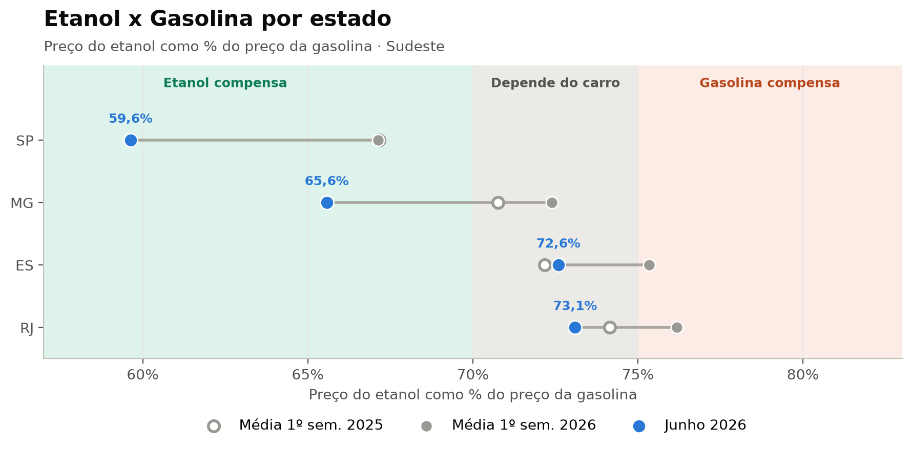
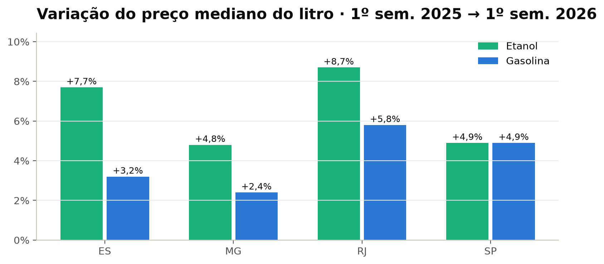
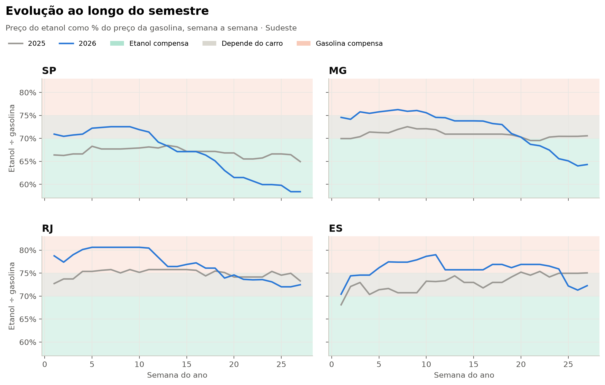
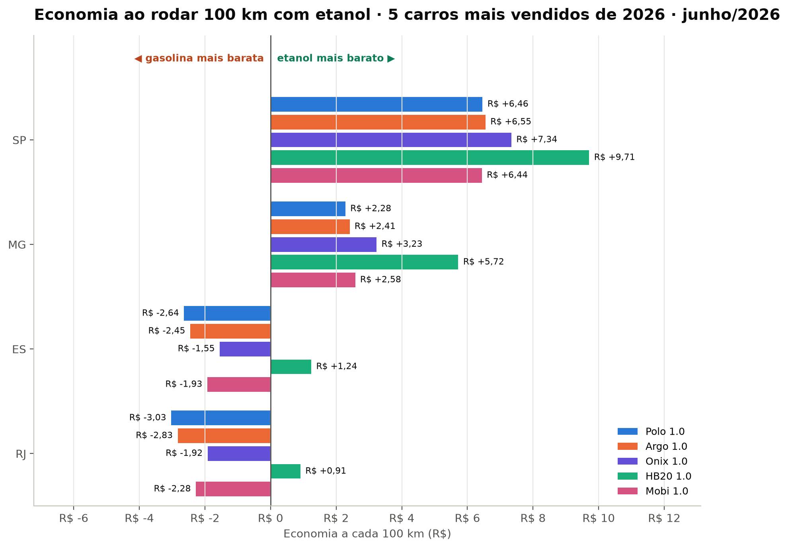

 ⛽ Etanol x Gasolina (Região Sudeste)

Sabe aquela dúvida na hora de abastecer, **etanol ou gasolina**? Neste projeto eu fui atrás da resposta com dados de verdade.

Usei **dados públicos do governo federal** com mais de 200 mil preços coletados nos postos dos quatro estados do Sudeste: **São Paulo (SP), Minas Gerais (MG), Rio de Janeiro (RJ) e Espírito Santo (ES)**. Comparei o **1º semestre de 2025** com o **1º semestre de 2026** para descobrir **onde e quando vale mais a pena abastecer com etanol**.

Tudo foi feito em **Python**, com três bibliotecas:
- **pandas**: para ler, limpar e organizar os dados em tabelas
- **numpy**: para os cálculos
- **matplotlib**: para os gráficos

---

## 📂 De onde vêm os dados

Todos os dados usados aqui são **públicos e gratuitos**, e qualquer pessoa pode baixá-los:

- **Preços dos combustíveis:** ANP (**Agência Nacional do Petróleo, Gás Natural e Biocombustíveis**), órgão do governo federal que pesquisa toda semana os preços nos postos do país. Usei os arquivos semestrais "Automotivos" de 2025 e 2026, disponíveis no site da ANP em **gov.br/anp** (série histórica de preços de combustíveis).
- **Consumo dos carros:** Inmetro (**Instituto Nacional de Metrologia, Qualidade e Tecnologia**), na tabela oficial de consumo de veículos de 2026, chamada **PBE Veicular** (Programa Brasileiro de Etiquetagem Veicular).
- **Carros mais vendidos:** ranking de 2026 da **Fenabrave** (Federação Nacional da Distribuição de Veículos Automotores), divulgado pela Webmotors.

---

## 🧮 A regra usada

O etanol rende menos que a gasolina, então ele só compensa se for **bem mais barato**. A conta é simples: **divida o preço do etanol pelo preço da gasolina**.

| Resultado | O que significa |
|---|---|
| até 70% | 🟢 **Etanol compensa** |
| de 70% a 75% | ⚪ **Depende do carro** (alguns modelos rendem mais com etanol) |
| acima de 75% | 🟠 **Gasolina compensa** |

---

## 📊 O que eu descobri



**Como ler este gráfico:** quanto mais à esquerda, mais barato está o etanol em relação à gasolina. A cor do fundo mostra o que compensa (🟢 etanol · ⚪ depende do carro · 🟠 gasolina). A bolinha azul é **junho de 2026**, o dado mais recente.

| Estado | Média do 1º semestre de 2026 | Junho de 2026 | Em resumo |
|---|---|---|---|
| **São Paulo (SP)** | 🟢 67,1% | 🟢 59,6% | Etanol compensa com folga |
| **Minas Gerais (MG)** | ⚪ 72,4% | 🟢 65,6% | Etanol passou a compensar no fim do semestre |
| **Espírito Santo (ES)** | 🟠 75,3% | ⚪ 72,6% | Gasolina compensou na maior parte do semestre |
| **Rio de Janeiro (RJ)** | 🟠 76,2% | ⚪ 73,1% | Gasolina compensou na maior parte do semestre |

### O etanol subiu mais que a gasolina



De 2025 para 2026, o etanol subiu mais que a gasolina no ES, em MG e no RJ. Em SP, os dois subiram igual (+4,9%).

### Mas em 2026 o jogo virou a partir de maio



**Como ler este gráfico:** quanto mais para baixo, mais barato o etanol. A linha cinza é 2025 e a azul é 2026. O etanol começou 2026 mais caro em todos os estados, mas a partir de maio a linha azul despencou: **SP e MG entraram no verde** (etanol compensa), enquanto **RJ e ES chegaram só ao cinza** (depende do carro).

### E no bolso, com os carros mais vendidos?



Peguei os **5 carros de passeio mais vendidos de 2026** (Polo, Argo, Onix, HB20 e Mobi) e calculei quanto custa rodar 100 km na cidade com cada combustível, usando o consumo oficial do Inmetro e os preços de junho de 2026:

- ✅ **Em SP e MG, o etanol saiu mais barato nos 5 carros.** Em SP, a economia chega a **R$ 9,71 a cada 100 km**.
- ❌ **No RJ e no ES, a gasolina saiu mais barata** no Polo, no Argo, no Onix e no Mobi.
- 💡 **A exceção foi o HB20:** como ele perde menos desempenho com etanol, o etanol compensa nele até cerca de 74% do preço da gasolina (nos outros, só até ~69–70%). Por isso, mesmo no RJ e no ES, abastecer o HB20 com etanol saiu mais barato.

Nas cidades, o etanol compensava em **todas as 96 cidades de SP** analisadas e em **45 de 53 de MG**, mas em só **2 de 27 do RJ**.

### 📌 Conclusão

No Sudeste, **o etanol vale mais a pena em SP e MG**. No **RJ e no ES, a gasolina** costuma compensar mais (ou depende do carro). A regra dos 70% é um bom ponto de partida, mas quem decide de verdade é **o seu estado, a época do ano e o seu carro**.

---

## 🛠️ Como o projeto foi feito

1. **Leitura:** juntei os dois arquivos da ANP (2025 e 2026) em uma única tabela, com 851 mil linhas.
2. **Entendimento:** conferi o tipo de cada coluna e onde havia dados faltando.
3. **Limpeza:** tirei 9.114 linhas vazias, colunas que não seriam usadas e registros repetidos.
4. **Tipos de dados:** transformei o preço de texto em número e a data de texto em data, e converti colunas repetitivas para o tipo "categoria". Com isso, o uso de memória caiu de 414 MB para 125 MB.
5. **Filtro:** fiquei só com a região Sudeste, o etanol e a gasolina comum (205 mil preços, 191 cidades e 4.738 postos).
6. **Análise:** variação dos preços, comparação etanol x gasolina por estado, evolução semana a semana, custo para rodar 100 km com os 5 carros mais vendidos e ranking das cidades.
7. **Conclusão.**

O notebook explica cada etapa e o porquê de cada decisão, com o código comentado em linguagem simples.

---

## ▶️ Como rodar na sua máquina

```bash
pip install -r requirements.txt
```

1. Baixe no site da ANP (**gov.br/anp**, em "Série histórica de preços de combustíveis") os arquivos semestrais "Automotivos" de 2025/01 e 2026/01 e coloque-os na pasta `dados/`.
2. Abra o arquivo `etanol_gasolina_sudeste.ipynb` e execute todas as células.

---

## ⚠️ Limitações

- As faixas de 70% e 75% são referências práticas; o rendimento real depende do carro e do jeito de dirigir.
- O consumo dos carros é o oficial do Inmetro, mas no dia a dia ele muda com o trânsito e a conservação do veículo.
- A ANP pesquisa uma amostra de postos e cidades, não todos.
- Os dados são de antes de agosto de 2026, quando a gasolina passou a ter 32% de etanol misturado (antes eram 30%). Essa mudança pode alterar um pouco a conta.

---

Feito por **Matheus Amaral** · [GitHub](https://github.com/MatheusAmaraal)
